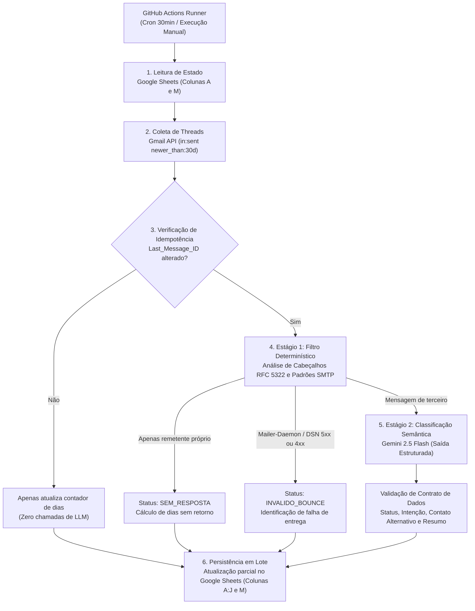

# [RFC-0001] Arquitetura do Motor de Triagem e Rastreamento de E-mails Outbound

| Metadados | Detalhes |
| :--- | :--- |
| **Status** | Aprovado / Em Implementação |
| **Data** | 2026-11-05 |
| **Escopo** | Engenharia de Dados, Automação Operacional, Integração LLM |
| **Integrações Afetadas** | Gmail REST API, Google Sheets API v4, Google Gemini API, GitHub Actions |

---

## 1. Contexto e Motivação

Equipes operacionais que realizam comunicações ativas em lote (*outbound*) — como processos seletivos, prospecção de parcerias, convites institucionais e cobranças de pendências — enfrentam perda de visibilidade logo após o envio inicial. O acompanhamento depende de verificação manual na caixa de saída e entrada do Gmail, gerando três problemas estruturais:

1. **Alto Custo Operacional de Verificação:** A necessidade de abrir dezenas ou centenas de *threads* individualmente para identificar quem respondeu, quem permanece sem retorno e quais envios falharam.
2. **Atraso na Reação a Eventos de Protocolo e Redirecionamento:** Falhas de entrega (*bounces* SMTP) e mensagens de ausência (*out of office*) que indicam contatos substitutos ficam misturadas a outros e-mails, atrasando a correção do endereço ou o redirecionamento do contato.
3. **Ausência de Estado Consolidado:** Não há uma visão única onde múltiplos membros da equipe possam filtrar pendências por tempo de espera, consultar o resumo do retorno e assumir a responsabilidade pelo atendimento sem colisão de trabalho.

---

## 2. Objetivos e Não-Objetivos

### 2.1. Objetivos (Goals)
* **Rastreamento Automatizado e Idempotente:** Sincronizar periodicamente as conversas iniciadas pela conta, processando apenas o diferencial ($\Delta$) de novas mensagens.
* **Redução de Custos de Inferência (FinOps):** Resolver cenários determinísticos via inspeção de cabeçalhos de protocolo (RFC 5322) antes de acionar modelos de linguagem (LLM).
* **Classificação Semântica Estruturada:** Categorizar respostas de terceiros em intenções acionáveis e extrair automaticamente endereços de e-mail alternativos quando houver indicação de outro responsável.
* **Persistência sem Infraestrutura Dedicada:** Utilizar o Google Sheets simultaneamente como interface operacional para a equipe e armazenamento de estado (*state store*), garantindo isolamento entre colunas gerenciadas pelo sistema e colunas editadas por humanos.
* **Custo Zero de Hospedagem:** Executar todo o ciclo em ambiente *serverless* efêmero via GitHub Actions.

### 2.2. Não-Objetivos (Non-Goals)
* **Geração ou Disparo Automático de Respostas:** O sistema atua exclusivamente na leitura, triagem e organização da fila. A resposta final ao destinatário permanece sob responsabilidade humana (*Human-in-the-Loop*).
* **Processamento em Tempo Real Estrito (Sub-segundo):** Não é objetivo deste projeto manter conexões persistentes ou *webhooks* de baixa latência, visto que o SLA operacional de resposta a e-mails é medido em minutos ou horas.
* **Substituição de Ferramentas de Disparo (Mail Merge):** O sistema monitora e classifica conversas já enviadas, não sendo responsável pelo envio inicial das campanhas em massa.

---

## 3. Desenho da Solução (Detailed Design)

### 3.1. Topologia e Fluxo de Dados

A arquitetura é executada como um *job* agendado (*stateless*), dividido em seis etapas sequenciais:



### 3.2. Controle de Estado e Sincronização Incremental (Delta Sync)

Como o ambiente de execução no GitHub Actions é efêmero, o estado de processamento é persistido na própria planilha operacional através de duas chaves:
* `Thread_ID` (Coluna `A`): Chave primária que identifica a conversa no Gmail.
* `Last_Message_ID` (Coluna `M`): Cursor que armazena o ID da última mensagem inspecionada naquela conversa.

Durante a execução, o serviço carrega em memória o mapa `{Thread_ID: Last_Message_ID}` da planilha. Ao listar as *threads* enviadas nos últimos 30 dias via Gmail API, o sistema verifica se o ID da última mensagem da *thread* coincide com o cursor salvo. Caso coincida, o conteúdo da conversa não sofreu alterações desde a última varredura — o sistema evita o *parse* completo e qualquer chamada ao LLM, recalculando apenas a contagem de dias em aberto caso a conversa siga com status `SEM_RESPOSTA`.

### 3.3. Pipeline de Classificação em Dois Estágios

Para evitar o uso de inferência probabilística em regras de protocolo, as conversas com novas interações passam por um funil de dois estágios:

1. **Estágio 1 — Filtro Determinístico de Protocolo (Local):**
   * **Detecção de Falhas de Entrega (*Bounce*):** Inspeciona os cabeçalhos `From`, `Subject` e `Content-Type` (`multipart/report`, `report-type=delivery-status`) em busca de remetentes de subsistema de correio (`mailer-daemon`, `postmaster`). Aplica expressões regulares no corpo técnico da notificação para distinguir erros permanentes (`5xx` — *Hard Bounce*) de falhas temporárias (`4xx` — *Soft Bounce*).
   * **Detecção de Ausência de Interação:** Filtra a lista de mensagens da *thread* comparando o remetente com o endereço da própria conta. Se todas as mensagens pertencerem ao remetente original (incluindo *follow-ups* enviados pela própria equipe), a conversa é classificada imediatamente como `SEM_RESPOSTA`.

2. **Estágio 2 — Classificador Semântico (Google Gemini 2.5 Flash):**
   * Acionado exclusivamente quando a *thread* contém mensagens de terceiros que não são erros de entrega.
   * O histórico cronológico da conversa é submetido ao modelo com temperatura zero (`0.0`) e restrição de esquema (*Constrained Decoding* / `response_schema`), obrigando o retorno de um payload JSON aderente ao contrato de dados da aplicação.

### 3.4. Contrato de Dados e Taxonomia

Toda análise concluída (seja pelo Estágio 1 ou pelo Estágio 2) produz uma estrutura padronizada composta por quatro atributos antes da persistência:

| Atributo | Tipo | Obrigatoriedade | Descrição |
| :--- | :--- | :---: | :--- |
| `status` | `Enum (ThreadStatus)` | Sim | Estado macro da conversa (`SEM_RESPOSTA`, `RESPONDIDO`, `PIVOTAR_REDIRECIONADO`, `AUSENTE_AUTO_REPLY`, `INVALIDO_BOUNCE`). |
| `intent` | `Enum (ReplyIntent)` | Sim | Detalhamento da resposta ou falha (descrito na tabela abaixo). |
| `alternative_email` | `String ( Nullable )` | Não | Endereço de e-mail extraído quando há indicação de novo contato ou substituto de férias. |
| `summary_context` | `String (<= 120 chars)` | Sim | Síntese objetiva em português resumindo a resposta ou o erro técnico. |

#### Matriz de Transição: Status vs. Intenção

| Status Macro (`ThreadStatus`) | Intenção Específica (`ReplyIntent`) | Origem da Decisão | Critério de Atribuição |
| :--- | :--- | :---: | :--- |
| `RESPONDIDO` | `POSITIVO_CONFIRMADO` | Estágio 2 (LLM) | Aceite de convite, confirmação de entrevista ou interesse explícito. |
| `RESPONDIDO` | `DUVIDA_OU_REAGENDAR` | Estágio 2 (LLM) | Pedido de informações adicionais, proposta de novo horário ou dúvidas. |
| `RESPONDIDO` | `RECUSADO` | Estágio 2 (LLM) | Declínio formal do convite, desistência ou falta de interesse/orçamento. |
| `PIVOTAR_REDIRECIONADO` | `INDICOU_OUTRO_CONTATO` | Estágio 2 (LLM) | Resposta humana ou aviso de ausência indicando terceiro para contato. |
| `AUSENTE_AUTO_REPLY` | `AUSENTE_SEM_SUBSTITUTO` | Estágio 2 (LLM) | Resposta automática de férias/licença sem indicação de substituto. |
| `INVALIDO_BOUNCE` | `ERRO_PERMANENTE_5XX` | Estágio 1 (Regra) | Código SMTP `5xx` (conta inexistente ou domínio inválido). |
| `INVALIDO_BOUNCE` | `ERRO_TEMPORARIO_4XX` | Estágio 1 (Regra) | Código SMTP `4xx` (caixa cheia ou servidor temporariamente indisponível). |
| `SEM_RESPOSTA` | `N/A` | Estágio 1 (Regra) | Nenhuma mensagem externa recebida desde o disparo. |

### 3.5. Isolamento de Concorrência na Escrita (Google Sheets)

Para permitir que a equipe utilize a planilha simultaneamente sem risco de perda de dados manuais, o layout de colunas é particionado em zonas de escrita:

* **Zona de Automação (Colunas `A` a `J` e Coluna `M`):** Atualizada pelo sistema a cada ciclo.
* **Zona Manual da Equipe (Colunas `K` e `L` — `Responsavel` e `Notas_Equipe`):** Exclusiva para edição humana.

Na etapa de persistência, o cliente de planilha não sobrescreve a linha inteira (`A:M`). Para cada registro atualizado, são geradas duas instruções de escrita matricial independentes (`A{linha}:J{linha}` e `M{linha}`), agrupadas em uma única chamada `batch_update`. Dessa forma, as células nas colunas `K` e `L` jamais são tocadas pela automação.

---

## 4. Alternativas Consideradas e Trade-offs

### 4.1. Ingestão: Polling Incremental (GitHub Actions) vs. Event-Driven (GCP Pub/Sub + Webhooks)
* **Alternativa Descartada (GCP Pub/Sub):** Configurar `users.watch` na Gmail API enviando eventos para um tópico Cloud Pub/Sub consumido por um serviço Cloud Run/Lambda.
* **Por que foi descartada:** Embora entregue latência de segundos, exige infraestrutura *cloud* provisionada, configuração complexa de permissões IAM, faturamento ativo no GCP e uma rotina paralela para renovar o registro do `users.watch` a cada 7 dias (limite da API do Gmail). O *polling* a cada 30 minutos no GitHub Actions atende integralmente à necessidade de negócio com custo zero e manutenção mínima.

### 4.2. Triagem: Funil Híbrido (Regras + LLM) vs. Processamento 100% LLM
* **Alternativa Descartada (100% LLM):** Enviar o conteúdo de todas as *threads* diretamente para o Gemini classificar, inclusive conversas sem resposta ou erros de servidor.
* **Por que foi descartada:** Em lotes de comunicação ativa, a maioria das conversas permanece sem resposta nos primeiros dias. Submeter esses registros ao LLM consumiria cota de API desnecessariamente, aumentaria a latência total do *job* e introduziria risco de alucinação em diagnósticos puramente determinísticos (como códigos SMTP `550`).

### 4.3. Armazenamento e UI: Google Sheets vs. Banco Relacional + Dashboard Web
* **Alternativa Descartada (PostgreSQL + Frontend Customizado):** Construir uma aplicação web própria com banco de dados dedicado para exibir a fila de triagem.
* **Por que foi descartada:** Criaria sobrecarga de desenvolvimento e sustentação de um sistema de CRUD/autenticação apenas para replicar funcionalidades nativas de uma planilha compartilhada (filtros por coluna, formatação condicional, edição colaborativa e facilidade de acesso por equipes não técnicas).

### 4.4. Estilo Arquitetural: Monólito Modular (Ports & Adapters) vs. Microsserviços Distribuídos
* **Alternativa Descartada (Microsserviços):** Separar a ingestão do Gmail, o motor de classificação de IA e o gravador de estado em serviços independentes comunicando-se via filas de mensagens ou chamadas HTTP.
* **Por que foi descartada:** O processamento de triagem é intrinsecamente sequencial e executado em janelas de lote (*batch*). Distribuir esse fluxo em microsserviços geraria um *monólito distribuído*, introduzindo latência de rede desnecessária, custos de orquestração de múltiplos *containers* e complexidade de rastreamento de falhas parciais.
* **Abordagem Adotada:** Unidade única de implantação (*Single Deployable Unit*) estruturada internamente sob **Arquitetura Hexagonal Simplificada (Ports & Adapters)**. O núcleo de domínio (contratos de dados e heurísticas determinísticas) permanece isolado das integrações externas (Gmail, Gemini e Google Sheets), permitindo substituir qualquer provedor externo (ex.: migrar do Google Sheets para um banco relacional ou CRM no futuro) alterando apenas a camada de adaptadores.

---

## 5. Requisitos Não-Funcionais e Impacto Operacional

### 5.1. Cotas de API, Rate Limiting e Performance
* **Google Sheets API:** Possui limite rígido de requisições de escrita por minuto por usuário. Para evitar erros `HTTP 429 (Too Many Requests)`, é proibido realizar chamadas `update_cell` dentro de laços de repetição. Toda a leitura inicial é feita em lote e toda a gravação ocorre em uma única requisição `batch_update` ao final do processamento.
* **Gemini API:** Graças ao filtro de idempotência (`Last_Message_ID`) e ao Estágio 1, o volume de chamadas ao Gemini por execução restringe-se apenas às *threads* que receberam respostas humanas ou avisos de ausência nos últimos 30 minutos, mantendo o consumo dentro da faixa gratuita ou de baixo custo da API.

### 5.2. Segurança e Gestão de Credenciais
* **Princípio do Menor Privilégio:** O acesso à Gmail API solicita escopo estrito de leitura (`gmail.readonly`), garantindo que a credencial não tenha permissão técnica para enviar, alterar ou excluir e-mails da conta.
* **Armazenamento de Segredos:** Chaves privadas (`GOOGLE_SERVICE_ACCOUNT_JSON`, `GMAIL_OAUTH_TOKEN_JSON` e `GEMINI_API_KEY`) nunca são versionadas no repositório; são injetadas em tempo de execução exclusivamente via *GitHub Encrypted Secrets*.
* **Privacidade de Dados:** Os corpos dos e-mails não são armazenados em bancos de dados intermediários nem registrados em *logs* de console do GitHub Actions; apenas o resumo executivo (máximo de 120 caracteres) e os metadados de triagem são persistidos na planilha privada da equipe.

### 5.3. Resiliência e Tratamento de Falhas
* **Falhas Parciais de Inferência:** Caso uma chamada específica ao Gemini falhe por instabilidade transitória de rede, o cursor `Last_Message_ID` daquela *thread* não é atualizado na planilha, garantindo que a conversa seja reprocessada automaticamente no ciclo seguinte (30 minutos depois) sem perda de dados.
* **Prevenção de Expiração de Token OAuth:** O aplicativo OAuth no Google Cloud Console deve ser configurado com status de publicação **"In Production"** para evitar a revogação automática de *refresh tokens* a cada 7 dias (comportamento padrão do modo *Testing*).

---

## 6. Arquitetura Interna de Componentes e Estratégia de Testes

### 6.1. Organização em Camadas (Ports & Adapters)
Para garantir baixo acoplamento e alta testabilidade dentro de uma única unidade de execução, o código-fonte é dividido em três camadas com dependências unidirecionais (Adaptadores e Pipeline dependem do Domínio; o Domínio não depende de pacotes externos de I/O):

```text
outbound-email-tracker/
├── .github/workflows/             # Definição do runner serverless (GitHub Actions)
├── docs/
│   └── ARCHITECTURE.md            # RFC-0001: Especificação arquitetural e decisões de projeto
├── src/
│   ├── config.py                  # Carregamento e validação estrita de variáveis de ambiente
│   ├── domain/                    # NÚCLEO DE DOMÍNIO (Zero dependências externas de rede/I/O)
│   │   ├── enums.py               # Taxonomias (ThreadStatus, ReplyIntent) e Matriz de Transição
│   │   ├── entities.py            # Entidades ricas (EmailThread, EmailMessage, TriageDecision)
│   │   ├── exceptions.py          # Exceções de invariantes de negócio e violação de contrato
│   │   ├── ports.py               # Contratos abstratos (Interfaces) exigidos dos adaptadores
│   │   └── protocol_inspector.py  # ProtocolTriageInspector (inspeção RFC 5322, DSN e SMTP)
│   ├── adapters/                  # ADAPTADORES DE INFRAESTRUTURA (Implementação das Ports)
│   │   ├── gmail_adapter.py       # Autenticação OAuth2, busca de threads e parsing MIME
│   │   ├── gemini_adapter.py      # Classificador Semântico (Gemini 2.5 Flash)
│   │   └── sheets_adapter.py      # Leitura de cursores e escrita parcial em lote (batch_update)
│   └── pipeline/                  # CAMADA DE APLICAÇÃO (Orquestração de Casos de Uso)
│       └── sync_service.py        # Coordena Delta Sync -> Protocol Inspector -> Semantic -> Sheets
└── tests/                         # Suíte de testes unitários isolados por camada
```

### 6.2. Garantia de Qualidade (Testes Offline)
A validação do sistema no pipeline de CI não depende de conexão com a Gmail API ou Gemini API, baseando-se em três suítes de testes unitários com *fixtures* locais:
1. **Testes de Protocolo (Estágio 1):** Verificam se *threads* contendo apenas mensagens do próprio remetente resultam em `SEM_RESPOSTA` e se notificações `mailer-daemon` são corretamente separadas entre códigos `5xx` e `4xx`.
2. **Testes de Contrato Semântico (Estágio 2):** Simulam o retorno do SDK `google-genai` para assegurar a deserialização estrita dos enumeradores e a extração de `alternative_email`.
3. **Testes de Integridade de Escrita:** Validam a função construtora de payloads do Google Sheets para garantir que nenhum intervalo gerado inclua as colunas manuais `K` e `L`.
